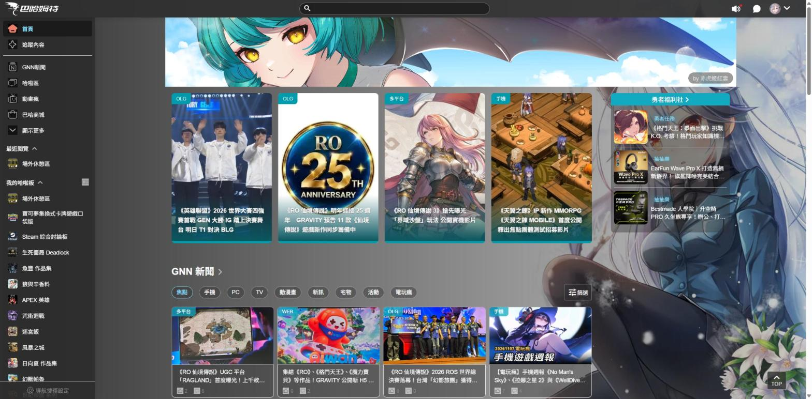
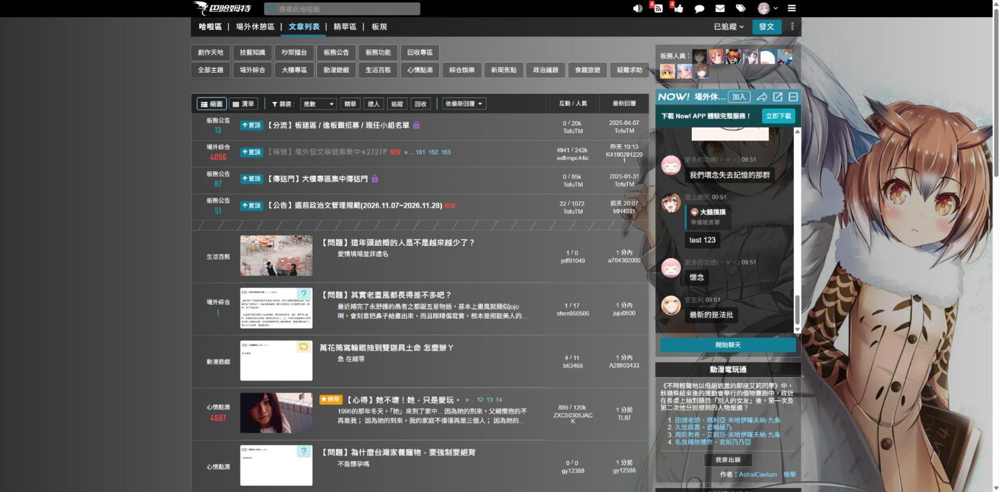
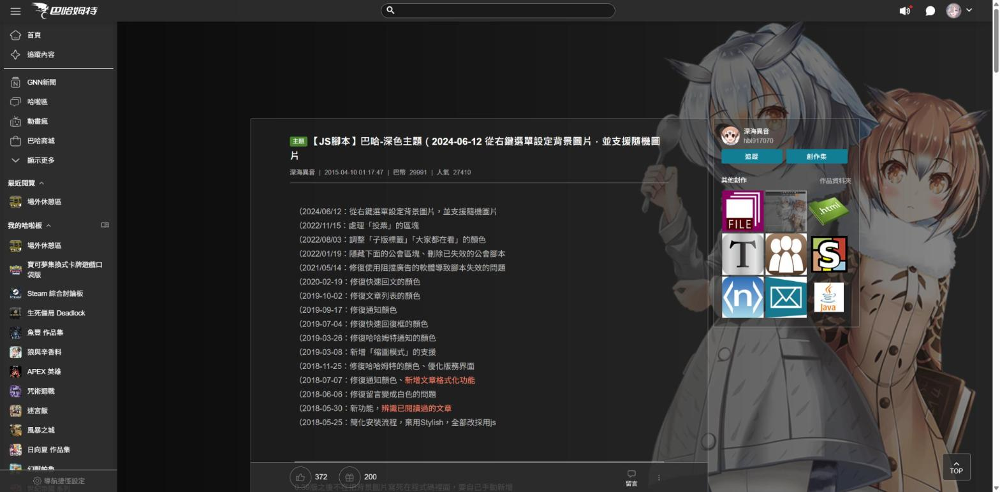

# 【巴哈JS腳本】巴哈姆特深色主題

## 安裝流程
### step 1：安裝Tampermonkey
從[官網](https://www.tampermonkey.net/)找安裝
或是[Chrome商店](https://chromewebstore.google.com/detail/tampermonkey/dhdgffkkebhmkfjojejmpbldmpobfkfo)安裝
（請務必使用Tampermonkey，其他腳本管理軟體未經測試不保證能執行。）

### step 2：安裝腳本
點擊 https://greasyfork.org/zh-TW/scripts/（發布後補上）
點安裝腳本 > 安裝

### step3（Chrome使用者）
在網址列輸入chrome://extensions/後按enter，將右上角的開發人員模式打開。

---

## 功能敘述
- 延續[深海異音](https://home.gamer.com.tw/hbl917070)的「[巴哈-深色主題](https://home.gamer.com.tw/artwork.php?sn=2803391)」，經原作者同意後繼續維護：
- 整個巴哈姆特都變成深色（哈啦區、首頁、小屋、GNN、動畫瘋、公會、商城…），並保留原作的背景圖片風格
- 原本的兩個腳本合而為一
- 背景圖片、遮罩、自訂 CSS 改從選單的「設定」修改，更新腳本後設定不會消失
- 補上網站改版後變回淺色的地方（巴哈首頁、哈啦區首頁、NOW! 聊天室等）
- 小屋主人有設定背景圖片時，會顯示小屋主人的圖片
- 發文時的預覽切到「闇黑」才會套用深色，切到「一般」維持原本的樣子，方便確認文章顏色
- （若有安裝原作者的兩個腳本，請先停用，背景圖片需要在設定裡重新填入。另外請關閉網站內建的闇黑模式。）

### 開啟前

### 開啟後

---

## 後記
歡迎裝我寫的其他腳本
[小屋](https://home.gamer.com.tw/profile/index_creation.php?owner=nathan60107&folder=425332)
https://greasyfork.org/zh-TW/users/223141-貝果
